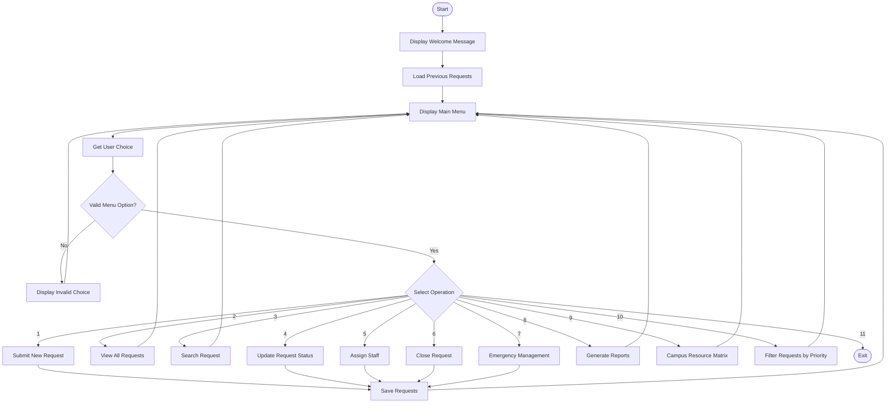

# Flowchart and Pseudocode

## 1. Main System Flowchart



## 2. Pseudocode

### Main Program

1. Start the program.
2. Display the welcome message.
3. Load previous requests from the file.
4. Display the main menu.
5. Get the user's menu choice.
6. Use a switch statement to select an operation.
7. Execute the selected function.
8. Repeat the menu until the user selects Exit.
9. End the program.

### Submit New Request

1. Check whether request storage is full.
2. Generate a unique request ID.
3. Ask for student name and department.
4. Ask for request category and description.
5. Validate request priority.
6. Ask for building and room information.
7. Set status to Pending.
8. Set assigned staff to Not Assigned.
9. Store the request in the array.
10. Save records to the file.
11. Display confirmation.

### Search Request

1. Check whether requests are available.
2. Ask for a request ID.
3. Search the request array.
4. If the ID exists, display the request.
5. Otherwise, display Request ID Not Found.

### Update Request Status

1. Ask for request ID.
2. Search for the request.
3. If the request exists, display status options.
4. Ask for the new status.
5. Update the status.
6. Save the updated records.
7. Display confirmation.

### Emergency Management

1. Check available request storage.
2. Generate a unique emergency ID.
3. Ask for name and department.
4. Ask for emergency type.
5. Ask for building and room.
6. Set category to Emergency.
7. Set priority to High.
8. Set status to Pending.
9. Store and save the emergency record.
10. Display confirmation.

### Generate Reports

1. Initialize all counters to zero.
2. Traverse all requests using a loop.
3. Count requests according to their status.
4. Count emergency requests.
5. Use recursion to count high-priority requests.
6. Display the final report.

### Campus Resource Matrix

1. Create a two-dimensional array.
2. Display resource matrix options.
3. Ask the user to record or display resource usage.
4. Validate building number and time slot.
5. Update the selected matrix element.
6. Use nested loops to display the matrix.

### Filter Requests by Priority

1. Check whether requests are available.
2. Ask for a priority level.
3. Validate the priority.
4. Allocate dynamic memory using a pointer.
5. Copy matching requests into dynamic memory.
6. Display the filtered requests.
7. Release allocated memory using delete[].

## 3. Conclusion

The flowchart and pseudocode describe the control flow and major modules of the Smart Campus Management System, including request handling, emergency management, reports, resource management, and dynamic memory operations.
```
