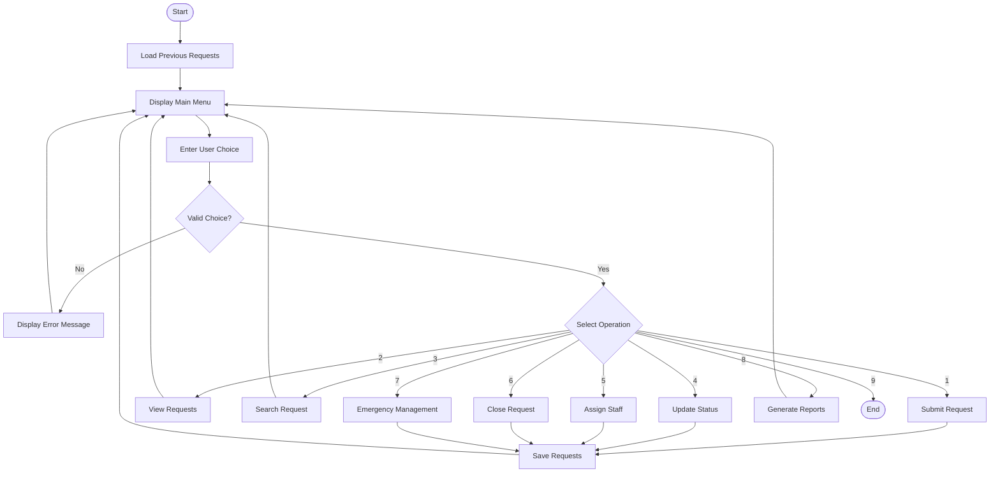

# Flowchart and Pseudocode

## 1. Main System Flowchart

## 2. Pseudocode

### Main Program
1. Start the program.
2. Load saved requests from the file.
3. Display the main menu.
4. Ask the user to enter a choice.
5. Use switch statement to select an operation.
6. Execute the selected function.
7. Repeat the menu until the user selects Exit.
8. End the program.

### Submit Request
1. Check whether request storage is full.
2. Ask the user for student information.
3. Validate all required fields.
4. Validate request priority.
5. Set status to Pending.
6. Store the request in the array.
7. Save records in the file.
8. Display confirmation.

### Emergency Management
1. Check available request storage.
2. Ask for name, department, emergency type, and location.
3. Validate required information.
4. Set category to Emergency.
5. Set priority to High.
6. Set status to Pending.
7. Save the emergency record.
8. Display confirmation.

### Generate Reports
1. Initialize all counters to zero.
2. Traverse all requests using a loop.
3. Count requests according to their status.
4. Count emergency requests.
5. Use recursion to count high-priority requests.
6. Display the final report.

## 3. Conclusion
The flowchart and pseudocode explain the program's overall control flow and the working of its major modules.
